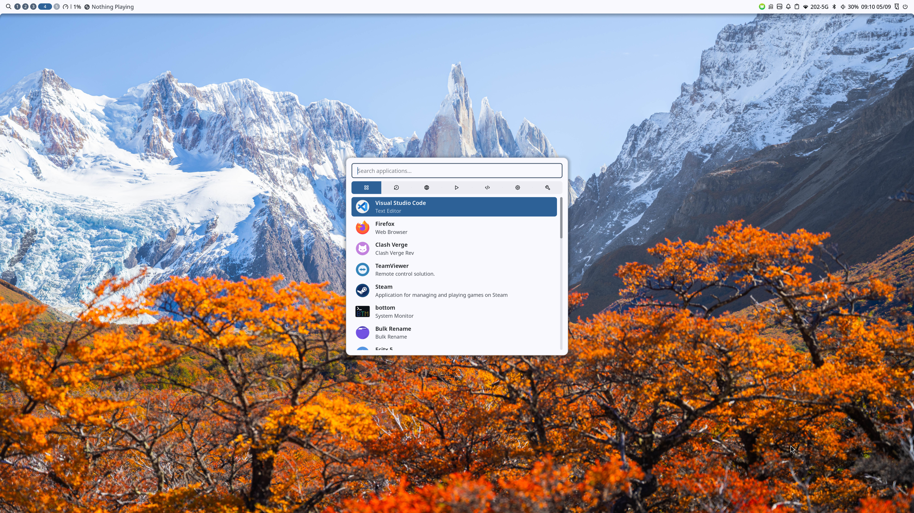

# ywxt NixOS configuration

Flake-based NixOS configuration for two hosts. System modules live in
`modules/`, per-host hardware in `hosts/`, and user configuration is
managed with [hjem](https://github.com/feel-co/hjem) instead of Home
Manager.

## Screenshot



## Hosts

| Host | Hardware | Add-on modules |
| --- | --- | --- |
| `ywxt-ws` | AMD desktop | `gaming`, `annepro2` |
| `ywxt-work` | Intel i7-12700, UHD Graphics 770 | `ohos`, `univpn`, `space-nav` |

Both share the same base — systemd-boot with the latest kernel, zram,
PipeWire, NetworkManager, Bluetooth, Clash Verge Rev, Docker, fcitx5
with the pinned `rime-huma` scheme — and the same disk layout: a btrfs
disk labelled `nixos` with `@`, `@home`, `@nix` subvolumes plus a
`boot` ESP.

## Layout

```
hosts/               Hardware and module selection per host
modules/             Shared NixOS modules
home/ywxt/           Shared hjem configuration (CLI only)
home/ywxt/desktop/   Desktop add-on: niri, noctalia, themes, kitty, thunar
pkgs/                Packages exposed through the flake overlay
templates/           Project templates (rust, frontend, python, cpp)
secrets/             sops-encrypted secrets and host-key backups
docker/              Container build contexts (ohos, univpn)
docs/                Screenshot and detailed guides
```

## Desktop

A TTY login starts Fish, which runs `uwsm start default`; UWSM launches
Niri and activates `graphical-session.target`. Noctalia is not spawned
by the compositor: it runs as a systemd user service bound to that
target, configured in `home/ywxt/desktop/noctalia.nix` through the
upstream hjem module, with settings inlined as Nix and validated at
build time. It handles locking, idle, suspend and brightness (DDC via
`ddcutil`), and pauses MPRIS players on lock. Monitor layouts are
declared per host through the `desktop.monitors` option and rendered
into a validated Niri `outputs.kdl`.

GTK, Qt and Kvantum are themed declaratively and recolored from
Noctalia's generated palette; MIME associations are declarative.

## Secrets

sops-nix with per-host age keys. The private key lives at
`/var/lib/sops-nix/key.txt`; recovery-key-encrypted backups are
committed under `secrets/host-keys/`. Edit secrets with the
`sops-secrets` helper. Restore, rotation and new-host procedures:
[docs/secrets.md](docs/secrets.md).

## Daily use

```bash
update    # nix flake update --flake ~/nixos-config
rebuild   # sudo nixos-rebuild switch --flake ~/nixos-config#(hostname)
nfi cpp   # init a project from a template (default: rust)
```

`update`, `rebuild` and `nfi` are Fish aliases defined in the shared
hjem configuration.

## Guides

- [Clean installation](docs/install.md)
- [Secrets management](docs/secrets.md)
- [OpenHarmony development](docs/ohos.md) — `ywxt-work`
- [UniVPN SSH access](docs/univpn.md) — `ywxt-work`
